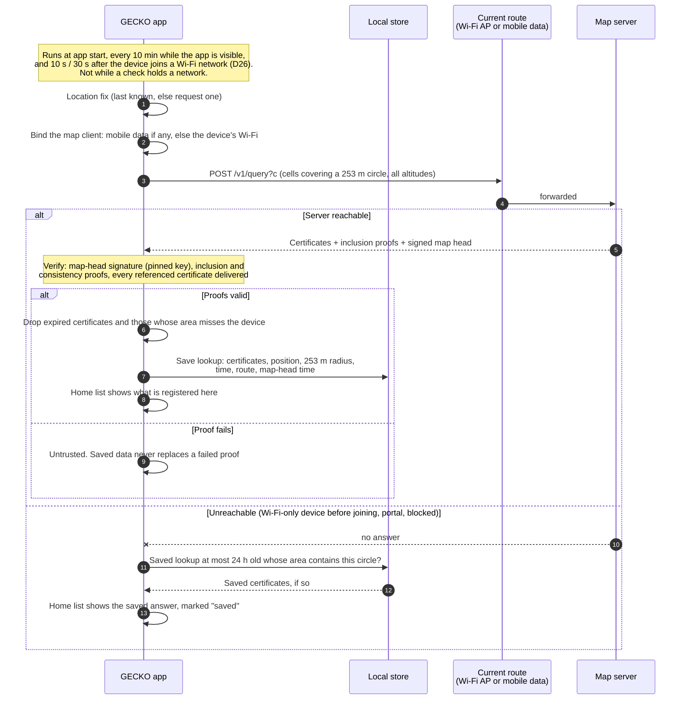
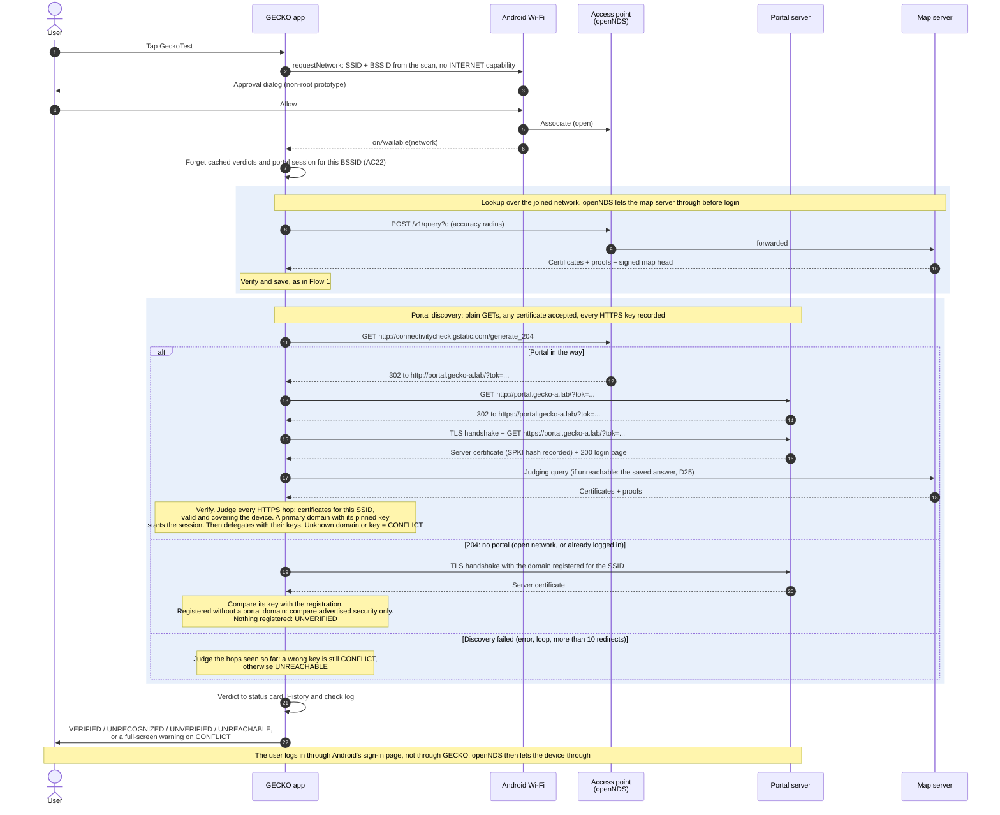
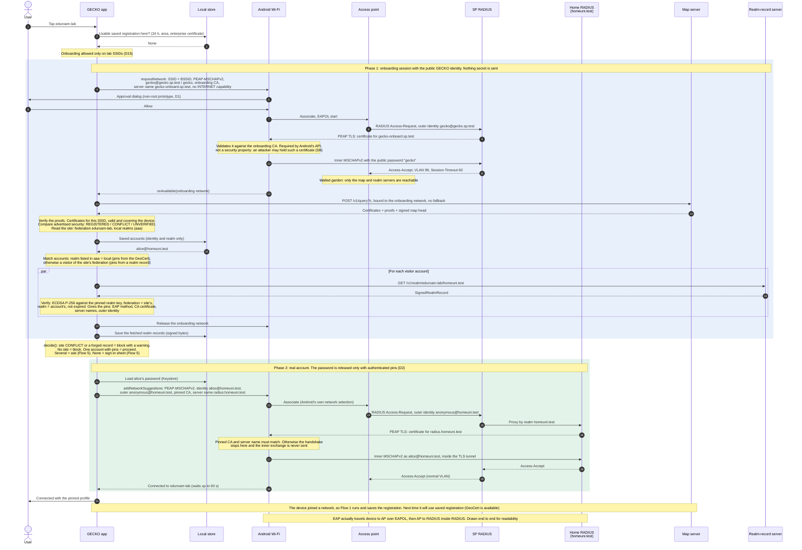
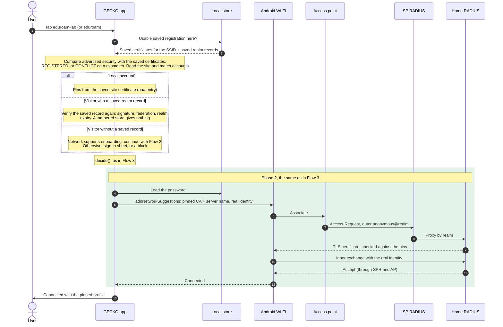

# Sequence diagrams

The diagrams are
[Mermaid](https://mermaid.js.org/syntax/sequenceDiagram.html): 

```
mkdir docs/diagrams
npx -p @mermaid-js/mermaid-cli@11.4.2 mmdc -i docs/sequence-diagrams.md -o docs/diagrams/out.md -e pdf
```

This writes one PDF per diagram (`out-1.pdf`, ...) next to a copy of this
file. Use `-e svg` for SVG. 

Flows 1 to 7 are system level: devices and servers, as in the thesis. Flow 8
is code level: the same enterprise flow as classes, for working on the app.
When a flow changes in the code, change its diagram in the same commit.

## Conventions

## Components

| Participant | What it does | In the lab | In the code |
|---|---|---|---|
| User | Taps a network, approves Android's dialogs, enters accounts | | |
| GECKO app | Looks up registrations, verifies answers, decides, installs profiles | Galaxy Tab A11| `ui/`, `verification/`, `eduroam/` |
| Android Wi-Fi | Joins networks for the app, runs EAP (wpa_supplicant), shows approval dialogs, picks networks from suggestions | One UI 8.5 | `NetworkObserver`, `SpecifierOnboardingSession`, `SuggestionProfileInstaller` |
| Local store | Saved lookup (the "cached GeoCerts"), saved realm records, accounts (passwords encrypted with a Keystore key), verdicts | App storage | `RegistrationCache`, `AccountStore`, `VerdictStore` |
| Access point | Broadcasts the SSID. Open networks: captive portal (openNDS). Enterprise: 802.1X authenticator in front of RADIUS | Router A genuine, Router B evil twin | |
| Portal server | Login page of the captive portal (openNDS external FAS) | `192.168.137.10` genuine, `.20` attacker | `portal/` |
| SP RADIUS | The visited network's RADIUS server. Handles the GECKO identity itself (walled garden) and proxies everyone else by realm | FreeRADIUS `legit` in WSL, through `udp-relay.py` | `lab/eduroam/radius/` |
| Home RADIUS | The user's home institution's server (realm `homeuni.test`). Checks the password | Same FreeRADIUS as the SP (D7). In eduroam it sits behind federation proxies | |
| Map server | GECKO map: answers "what is registered here" with inclusion proofs and a signed map head | geopki + Trillian, `192.168.137.1:1234` | `GeckoClient`, key in `PinnedServerKey` |
| Realm-record server | Serves signed realm records: the login-server pins for a realm within a federation | `lab/realm`, `192.168.137.1:1235`, signed offline | `RealmRecordClient`, key in `PinnedRealmKey` |

## Flow 1: Registration lookup

It runs on its own, not when the user taps a network.



## Flow 2: Open network with a captive portal

The user taps an open network (lab: `GeckoTest` on Router A). GECKO joins it
itself and checks the login page before the user logs in.



On the evil twin (Router B, attacker portal `.20`), the chain ends at a domain
or key that the SSID's registration doesn't list. Due to SSID exclusivity,
the user sees the warning.

## Flow 3: Enterprise Network (fetch GeoCerts)

The user taps `eduroam-lab` and GECKO has no usable saved registration
there. Phase 1 joins with the public GECKO identity to fetch the
registration and the realm record. Phase 2 joins with the user's real
account, pinned to the verified login server.



## Flow 4: Enterprise Network (GeoCert available)

The user taps an enterprise network for which GECKO already holds a GeoCert (so we know its registered and have the expected certificate). 
There is no onboarding session and the GECKO identity is never sent. This also works where GECKO onboarding isn't supported, such as at
real eduroam.



No map server and no realm server take part, and Android shows no approval
dialog.
